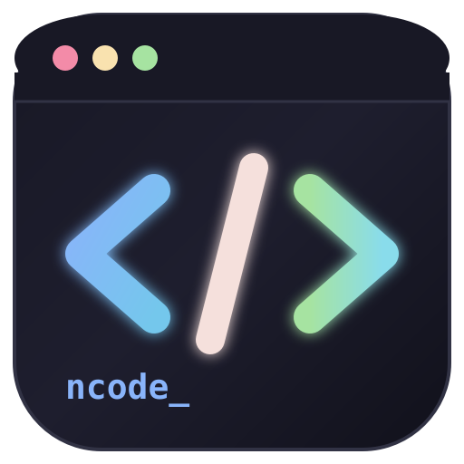

<h1 align="center">
  <br/>
  ncode — Nitin Editor
</h1>

<p align="center">
  A fully local desktop code editor for Linux — with DSA Practice, Live AI Chatbot, multi-language runner, integrated terminal, and SQL executor.
</p>

<p align="center">
  
  
  
  
  
</p>

---

## ⚡ Quick Start (after cloning)

```bash
git clone https://github.com/nitinsingh2006/ncode.git
cd ncode
bash setup.sh --compilers   # one-time: creates venv, PySide6 + installs C++, Java, Rust, Node
./run.sh                    # launch the editor
```

> **That's it.** `setup.sh` automatically checks for missing compilers (g++, javac, rustc, node) and installs them along with Python dependencies.

---

## ⚠️ What Won't Work Without Setup

| Feature | Problem after clone | Fix |
|---|---|---|
| **App won't start** | PySide6 not installed | Run `bash setup.sh` once |
| **Compilers (C++, Java, Rust)** | Missing system tools | `bash setup.sh --compilers` installs them all automatically! |
| **DSA questions missing** | `questions.db` is gitignored | Auto-created on first launch ✅ |
| **AI Chatbot** | No Groq API key | Add key in Settings → Preferences |
| **DSA Check Solution** | No Groq API key | Same — add key in Settings |
| **AI Transpiler** | No Groq API key | Same — add key in Settings |

### Get a FREE Groq API key
1. Go to → **https://console.groq.com**
2. Sign up (free)
3. Create API key
4. In ncode: **Settings → Preferences → Groq API Key** → paste it → Save

### Install language compilers (optional, per language you want to use)

```bash
# C / C++
sudo apt install gcc g++

# Java
sudo apt install default-jdk

# JavaScript / TypeScript (Node)
sudo apt install nodejs npm
npm install -g typescript

# Go
sudo apt install golang

# Rust
curl --proto '=https' --tlsv1.2 -sSf https://sh.rustup.rs | sh

# Ruby
sudo apt install ruby

# Kotlin
sudo apt install kotlin

# PHP
sudo apt install php-cli
```

> Python 3, Bash, HTML/CSS, SQL — work out of the box, no install needed.

---

## ✨ Features

### 🖊️ Code Editor
- Syntax highlighting for **18+ languages** (Pygments-powered)
- Multi-tab editor — open, close, reorder tabs freely
- Line numbers, auto-indent, bracket matching
- Find & Replace (`Ctrl+H`)
- Font size zoom (`Ctrl++` / `Ctrl+-`)
- Word wrap toggle

### ▶️ Code Runner
- Run code with `Ctrl+Enter` or `F5`
- Supports: Python, C, C++, Java, JavaScript, TypeScript, Go, Rust, Ruby, Kotlin, Swift, PHP, Bash, R, Lua, Perl, Scala, SQL, HTML/CSS
- Output appears in the **OUTPUT** panel at the bottom
- Stop long-running programs with `Ctrl+Shift+C`

### 🌐 HTML/CSS
- Opens directly in your **default browser** (Chrome/Firefox)
- In-editor **live preview** with `Ctrl+Shift+P`

### 🗄️ SQL
- Execute SQL scripts locally via **SQLite** (no server needed)
- Results shown as formatted table in output panel

### 💻 Integrated Terminal
- Real bash terminal inside the editor
- Safety prompts for dangerous commands (`rm -rf`, `shutdown`, etc.)
- Command history

### 🤖 AI Code Transpiler
- Convert code from one language to another via Groq AI
- Shortcut: `Ctrl+Shift+T`
- Requires: Groq API key

### 🧩 DSA Practice
- **187 questions** — Striver's SDE Sheet + NeetCode 150
- 21 topics: Arrays, Trees, DP, Graphs, Linked List, Binary Search, and more
- Opens question in editor with: problem statement + starter code (11 languages)
- AI checks your solution: verdict, issues, complexity, hint
- Tracks solved questions with ✅ progress bars
- Shortcut: `Ctrl+Shift+D` (toggle sidebar), `Ctrl+Shift+G` (check solution)

### 💬 Live AI Chatbot
- Side panel chatbot powered by Groq
- **Context-aware** — always sees the code in your current tab
- Chat in **Hindi, English, or Hinglish**
- User messages: right-aligned purple (ChatGPT style)
- AI messages: left-aligned with green accent (Claude style)
- Quick chips: `💡 Explain` / `🐛 Debug` / `⚡ Optimize`
- Shortcut: `Ctrl+Shift+I` or toolbar `💬 Chat` button

---

## 🗂️ Project Structure

See [`tree.md`](tree.md) for the full annotated file map.

```
ncode/
├── app/
│   ├── main.py          # Entry point — NitinEditor(QMainWindow)
│   ├── editor.py        # CodeEditor with syntax highlighting
│   ├── compiler.py      # Language configs + compilation
│   ├── runner.py        # Background subprocess runner
│   ├── chatbot.py       # Live AI Chatbot panel
│   ├── ai_transpiler.py # Language transpiler via Groq
│   ├── settings.py      # Settings load/save
│   ├── dsa/             # DSA Practice module (187 questions)
│   ├── sql/             # SQL executor
│   ├── terminal/        # Integrated terminal
│   └── ui/              # Settings dialog
├── tests/               # 74 pytest tests (all passing)
├── assets/              # App icons
├── setup.sh             # One-time setup script
├── run.sh               # Launch script
├── tree.md              # Full project map for developers/AI
└── requirements.txt     # PySide6>=6.6.0 (only dependency)
```

---

## ⌨️ Keyboard Shortcuts

| Shortcut | Action |
|---|---|
| `Ctrl+Enter` / `F5` | Run code |
| `Ctrl+Shift+C` | Stop execution |
| `Ctrl+N` | New tab |
| `Ctrl+O` | Open file |
| `Ctrl+S` | Save |
| `Ctrl+H` | Find & Replace |
| `Ctrl+,` | Settings |
| `Ctrl+Shift+D` | Toggle DSA sidebar |
| `Ctrl+Shift+G` | Check DSA solution (AI) |
| `Ctrl+Shift+T` | AI code transpiler |
| `Ctrl+Shift+I` | Toggle AI Chatbot |
| `Ctrl+Shift+P` | HTML preview |
| `Ctrl++` / `Ctrl+-` | Zoom in/out |

---

## 🧪 Running Tests

```bash
source .venv/bin/activate
python3 -m pytest tests/ -q
# 74 passed
```

---

## 🛠️ Requirements

| Requirement | Version |
|---|---|
| OS | Linux (Ubuntu 20.04+) |
| Python | 3.10+ |
| PySide6 | >= 6.6.0 |
| Groq API key | Free at console.groq.com |

> **No other pip packages required.** All AI calls use Python stdlib `urllib`.

---

## 📁 Data Files (auto-created, never in git)

| File | Location | What it stores |
|---|---|---|
| Settings | `~/.config/nitin-editor/settings.json` | Theme, font, API key, recent files |
| Solutions | `~/.local/share/nitin-editor/solutions.db` | Your saved DSA solutions |
| Questions DB | `app/dsa/questions.db` | Auto-seeded on first launch |

---

## 🤝 Contributing

1. Fork the repo
2. `bash setup.sh`
3. Make changes
4. `python3 -m pytest tests/ -q` — all 74 must pass
5. Open a PR

---

<p align="center">Made by <b>Nitin Singh</b> · <a href="https://github.com/nitinsingh2006/ncode">github.com/nitinsingh2006/ncode</a></p>
